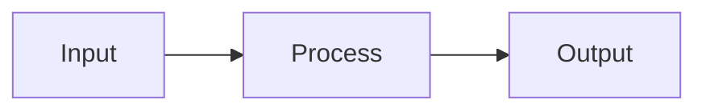
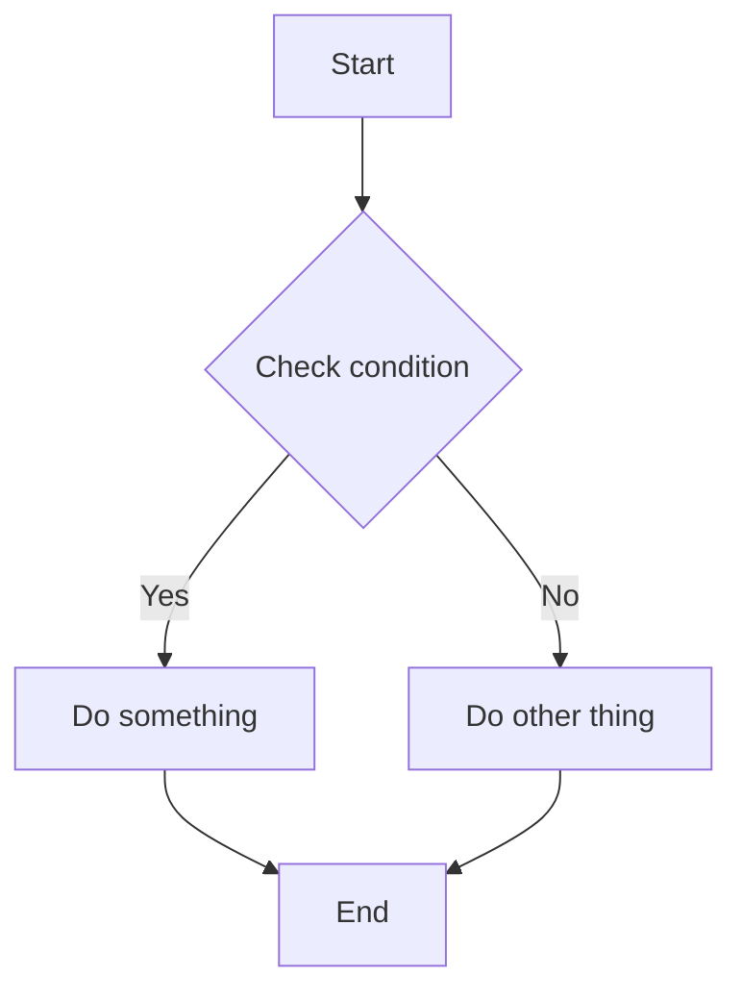
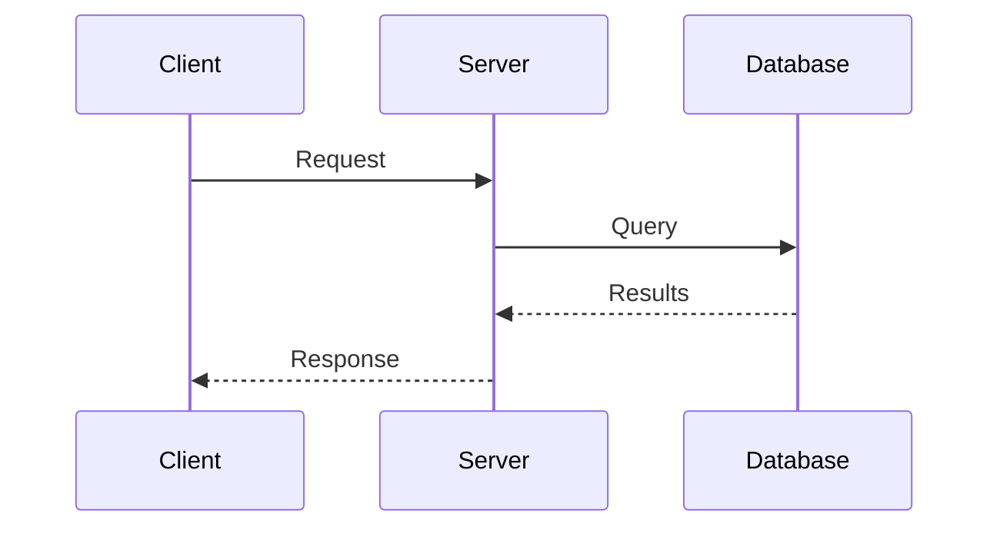
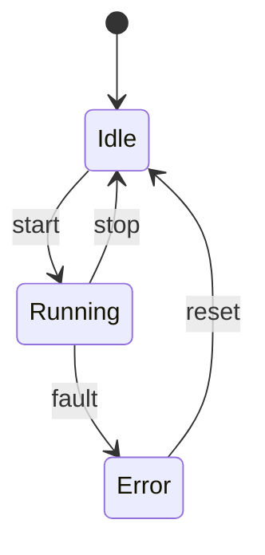

# Mermaid Filter

The Mermaid filter converts Mermaid diagram code blocks into rendered images for inclusion in \ac{PDF} output.

## Location

```
latex/filters/pandoc-mermaid.py
```

## Purpose

Mermaid is a text-based diagramming language that produces flowcharts, sequence diagrams, state machines, and more. This filter enables writing diagrams in Markdown and having them rendered automatically.

## Prerequisites

The filter requires:

- Node.js and npm
- Mermaid \ac{CLI} (`@mermaid-js/mermaid-cli`)
- Chromium or Chrome (for headless rendering)

Install via:

```bash
npm install @mermaid-js/mermaid-cli@10.9.1
```

## Syntax

Use fenced code blocks with the `mermaid` language identifier:

````markdown

````

## Supported Diagram Types

| Type | Keyword | Description |
|------|---------|-------------|
| Flowchart | `graph` or `flowchart` | Process flows and decision trees |
| Sequence | `sequenceDiagram` | Interaction sequences |
| Class | `classDiagram` | \ac{UML} class diagrams |
| State | `stateDiagram-v2` | State machines |
| ER | `erDiagram` | Entity-relationship diagrams |
| Gantt | `gantt` | Project timelines |
| Pie | `pie` | Pie charts |

## Examples

### Flowchart

````markdown

````

### Sequence Diagram

````markdown

````

### State Diagram

````markdown

````

## Configuration

### Mermaid Config

Customize diagram appearance in `config/mermaid-config.json`:

```json
{
  "theme": "default",
  "themeVariables": {
    "nodeBorder": "#004990",
    "mainBkg": "#c9d7e4",
    "nodeTextColor": "#274059"
  }
}
```

Every diagram gets this file and `config/mermaid.css` unless its block sets
`config=` or `cssFile=` itself.

### Puppeteer Config

`config/puppeteer.json` is passed to mmdc for every diagram. It turns off
Chrome's sandbox and uses the Chrome that Puppeteer downloaded during
`npm ci`:

```json
{
  "args": ["--no-sandbox", "--disable-setuid-sandbox", "--font-render-hinting=none"]
}
```

A `.puppeteer.json` in the directory pandoc runs from takes its place, and
`PUPPETEER_CFG` names another file. Add `"executablePath"` to use a system
Chromium instead of the downloaded one.

## Processing

The filter:

1. Detects Mermaid code blocks
2. Writes content to temporary file
3. Invokes `mmdc` to render \ac{PNG}/\ac{PDF}
4. Replaces code block with image reference
5. Cleans up temporary files

Output images are stored in `build/mermaid_images/`.

## Troubleshooting

### Diagrams Not Rendering

Check that mmdc is installed:

```bash
./node_modules/.bin/mmdc --version
```

### Chrome Not Found

Puppeteer downloads Chrome into `~/.cache/puppeteer` during `npm ci`. If
that was skipped, run it again from the pipeline directory:

```bash
node node_modules/puppeteer/install.js
```

To use a system Chromium instead, set `executablePath` in `puppeteer.json`
(for example `/usr/bin/chromium` on Arch). Avoid Ubuntu's snap
`chromium-browser`: its private `/tmp` breaks Puppeteer.

## Limitations

- Interactive features (clicks, tooltips) don't work in \ac{PDF}
- Very large diagrams may need manual sizing
- Some advanced Mermaid features require specific versions
